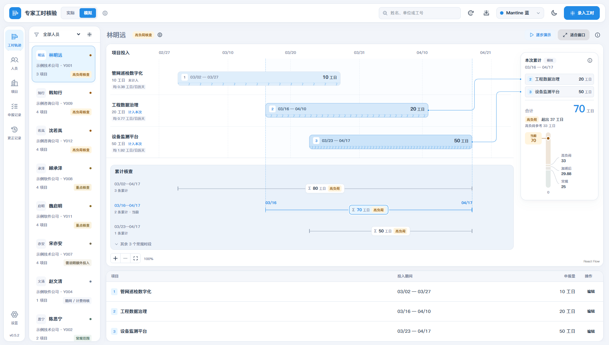

<div align="center">

# 专家工时校验工具

**按人员核对跨项目投入，让累计、参考量和待核事项都有来源。**

React 19 · Vite 8 · Python 3.10+ · SQLite

[快速开始](#快速开始) · [功能与使用](#功能与使用) · [核验口径](#核验口径) · [数据与备份](#数据与备份) · [开发与协作](#开发与协作) · [项目文档](#项目文档)

</div>

面向专家及技术人员工时台账的本地 Web 工具。以人员为中心展示跨项目时间轴，分别检查**累计投入、项目实施期、职称与计费依据**；录入后核验，编辑保存后重算，并保留更正历史。

> **当前状态（2026-11-25）**：应用版本字段为 **0.7.0**，规则版本为 **0.1.0（simulation）**。本次更新汇总本地后续完善至 `main`，包括 Excel 分批保存、人员资格证、PDF、日历维护、跨年显示和删除恢复。提交到 GitHub 不等于部署到单位服务器；历史内网部署记录不能证明服务器已经运行本次更新。
>
> 本工具提供模拟规则筛查。期间交叉、超出参考量和合同计费差异分别表达，筛查结果不直接作为重复报工、违规或结算审减结论。

## 快速开始

### 环境要求

| 环境 | 用途 |
| --- | --- |
| Python 3.10+，带 `sqlite3` | 运行服务；核心核验、Excel 解析和存储使用标准库 |
| Node.js 20.19+（20 系列）或 22.12+（22 及后续系列），带 npm | 安装依赖与构建；构建后日常运行不需要 Node.js |
| ReportLab 4.x | 生成 PDF；依赖范围见 `requirements-pdf.txt` |

### 安装和启动

```bash
git clone https://github.com/zgzzmnbx/zaojia-WorkTime.git
cd zaojia-WorkTime

# 使用当前主线
git switch main

npm ci
python -m pip install -r requirements-pdf.txt
npm run build
python server.py
```

建议在项目虚拟环境中安装 Python 依赖，并使用同一 Python 解释器启动服务。未安装 ReportLab 时仍可使用核心台账功能，PDF 导出会提示补装依赖。

| 入口 | 本机地址 | 首次创建的内容 |
| --- | --- | --- |
| 实际台账 | [http://127.0.0.1:8791/](http://127.0.0.1:8791/) | 空台账，自行录入 |
| 模拟案例 | [http://127.0.0.1:8791/?demo=1](http://127.0.0.1:8791/?demo=1) | 12 人、6 项目、34 条申报 |

顶部“实际 / 模拟”切换两套独立台账。两者均使用模拟筛查规则，区别在于数据来源；已有数据库不会因再次启动而重置。

Windows 首次构建后，可双击 `启动工时核验-【codex】.bat` 启动并打开浏览器。启动器优先查找项目 `.venv` 等可用 Python，不抢占其他应用的端口。

独立测试时可指定其他端口和数据目录：

```bash
python server.py --port 8792 --data-dir ./data-local
```

源码服务只监听 `127.0.0.1`。浏览器无法打开时，先确认服务终端没有退出、端口未被占用，且已生成 `dist/index.html`。修改前端后需重新执行 `npm run build`。

### 内网部署

仓库保存了 2026-11-09 的麒麟 A 部署记录，历史入口为 `http://10.54.9.47:8791/`，模拟入口加 `?demo=1`；记录中的网关限制来源为 `10.54.9.0/24`。**当前可达性及本次完善版的服务器升级尚未验收。**

由运维人员按 [部署、备份与回滚说明](00-docs/麒麟A内网部署-【codex】.md) 另行发布。麒麟系统自带的 Python 3.7 不符合要求；使用说明中的独立运行时，PDF 依赖还需安装在服务实际使用的 Python 环境。程序与数据分离，升级不得覆盖真实台账。

## 功能与使用

| 功能 | 当前行为 |
| --- | --- |
| 跨项目工时图 | 按人员展示全部有效日期记录，独立选择核查窗口，连接线对应完整计入的申报与右侧算式 |
| 数值化比较 | 展开工作日参考、模拟加班后参考、日历天参考，显示申报合计及差额 |
| 四级风险 | 低风险绿色、中风险黄色、高风险红色、极高风险紫色；依据不足另行提示待补或暂估 |
| 风险列表 | 汇总当前人员全部工期风险与待核事项，点击整行或按 Enter / 空格联动图中范围与依据 |
| 人员资格证 | 四类级别、资格证图片和有效期；已有人员可复用资料，新人需补齐规定信息 |
| 项目批量录入 | 新建项目可同时添加多人申报；已有项目可补录、导入 Excel |
| Excel 问题修复 | 通过行可先保存，问题行可暂存、逐行修复或单独导出后重导 |
| PDF / CSV 导出 | 按项目或人员范围核查；PDF 分开呈现本次项目申报与同一人员在当前全台账的累计背景 |
| 删除与恢复 | 项目、人员、申报移入“已删除记录”；恢复时检查关联与冲突，保存历史并重算 |
| 日历维护 | 月历核查、内置日历包、JSON 导入及配置内网日历源，支持每周自动同步 |
| 备份和历史 | JSON 备份恢复、恢复前自动备份、修订号冲突检查和只读历史快照 |

### 基本流程

1. 新建项目，维护建设期、实施期及对应依据。
2. 选择已有人员，或补齐新人的姓名、所属单位、工号、级别和资格证。
3. 录入实际投入期间、申报数量与单位；需要计费核对时填写合同依据。
4. 选择人员与核查窗口，核对计入来源、参考量、实施期及计费事项。
5. 有误则编辑原记录并保存重算；需要提交审核时导出报告并保存备份。

当前按录入量核验，无应用内认定、签字审批或认定顺序流程。同名人员按内部 ID 区分，所属单位与工号用于身份核对。界面支持四种主题及亮暗模式；超过 60 天且没有申报的时间空档默认折叠，可展开恢复连续时间轴。

### Excel 导入与人员资料

- 从项目“录入 / 导入”下载模板，在“人员工时”表填写；优先使用页面生成的最新版，人员名单随实际 / 模拟库分别生成。保留对旧模板布局的兼容。
- 已有人员从名单选择并复用资料；新人员补齐身份、四类级别及资格证要求。资格证支持 JPG、PNG、WebP，单张不超过 3 MB，默认长期有效，也可设置起止日期。
- 申报单位仅支持**工日、工时**。公共日期、单位及计费依据可统一填写，个人已填内容优先；支持 Excel 日期及文本日期格式。
- 导入先解析预览，不会立即写入台账。通过行可先保存，问题行在当前浏览器暂存，并可逐行检查或单独导出后修复重导。**暂存不等于服务端保存，换电脑或清理浏览器数据不会带走暂存内容**；转交前应导出问题行。
- 文件限 `.xlsx`、8 MB、最多 2000 条申报。不执行宏或用户填入的公式；模板自带的受支持显示公式按模板规则处理。
- 新项目和人员申报一次保存，取消时不写入台账；疑似重复需核对是追加还是重复，不自动覆盖既有申报。

四类级别为技术专家、项目经理、高级技术人员、一般技术人员。级别名称不自动转换成合同单价，计费仍需填写有来源的依据。

### PDF 与 CSV

项目行“导出核查”汇总该项目人员；人员行“导出核查”可勾选项目，默认选择有预警或待补事项的项目。预览后可下载 PDF 或 CSV。人员报告保留已选范围，同时列出当前全台账的累计背景。

PDF 需要 ReportLab 和可用中文 TrueType 字体。服务优先查找系统中文字体；缺字时，可设置 `EXPERT_HOURS_PDF_FONT` 指向有权使用的中文 TTF 文件，然后重启服务。

金额只在数量、单价和单位可比较时计算；缺项或单位不一致时提示待补，不能按零金额或“通过”处理。

### 日历

内置日历包不会自动替代已保存台账中的日历。请在“设置 → 日历核查与内网更新”核对年度来源、休息日与补班日，确认后保存。

可配置兼容的内网 JSON 日历源并选择每周自动同步；需要后端持续运行，连接失败保留旧日历。程序不会自行从公网抓取最新安排，完整年度及更新渠道需由维护人员确认。格式和限制见 [日历内网更新说明](00-docs/日历内网更新-【codex】.md)。

## 核验口径

- **完整窗口累计**：只累计完整落入窗口的有效申报。不同窗口可互相包含，其合计或差额不能再次相加。
- **工日 / 工时**：工日直接累计，工时按当前“每工日小时数”折算。旧人月记录保留原值，提示单位待更正，暂不计入累计；不得自动换算或删除原记录。
- **参考量**：工作日由台账日历计算；加班后参考在工作日基础上增加模拟加班折合量；最高参考取日历天数与加班后参考的较大者。参数、容差及日历来源需一并核对。
- **四级风险**：在配置容差内依次比较工作日参考、加班后参考、最高参考，分别为低、中、高风险，超过最高参考为极高风险。颜色只表达当前筛查等级，不代替事实认定。
- **期间交叉**：日期相交不代表实际重复报工。没有逐日投入时，不把完整申报量或按天分摊量作为交叉段实际量。
- **平均投入密度**：项目条深浅和底部刻纹表示整段申报工日除以含首尾日历天数，不是逐日投入，也不参与交叉段分摊。
- **依据不足**：日期、数量、年度日历、资格证或合同依据不足时提示待补。只有项目实施期时可作明确标注的暂估，不能冒充实际投入期。
- **结论边界**：实施期外投入、容量预警和计费差异分开列示；当前未启用正式合同审减规则或自动结算决定。

### 模拟案例

在模拟入口按姓名搜索：

| 人员 | 场景 |
| --- | --- |
| 林明远 · 示例技术公司 | 三项目共 58 工日，核对完整来源、47 日历天窗口与逐步演示 |
| 陈思宁 / 周启航 | 期间交叉但累计未超参考 / 两项目先后接续 |
| 赵文清 | 实施期外投入与计费差异，分别检查 |
| 陆景和 / 宋亦安 / 顾承泽 / 韩知行 | 同期分别申报 24 / 32 / 38 / 48 工日，比较四级风险 |
| 魏启明 | 304 工时按模拟参数折合 38 工日 |
| 沈若岚 | 全期 36 工日，但局部 12 日历天内申报 18 工日 |
| 许嘉禾 | 缺投入日期与数量，保持待补 |

样例人物、单位、项目、合同与日历均为模拟资料，不能直接用作真实年度日历。同名的另一位林明远独立计算。

## 界面预览

以下为仓库保留的历史模拟界面示意；最新四级风险配色、数值标准和删除恢复以当前主线实际页面为准。



<details>
<summary>查看深色界面示意</summary>


</details>

页面字体由本地服务提供，系统字体可回退；现有字体来源与内部测试范围见 [字体说明](public/fonts/README.md)。

## 数据与备份

```text
data/
├── ledger.sqlite3    # 实际台账
├── demo.sqlite3      # 模拟案例
└── backups/          # 恢复前自动备份
```

数据库首次启动创建，源码仓库不包含本机真实台账、资格证附件或导出的业务报告。两套数据分开保存，升级或复制程序时切勿覆盖 `data/`。

JSON 备份包含当前台账、参数、日历、资格证（含已删除记录引用）及最近 200 条历史摘要；每个历史版本的完整正文保存在 SQLite 中。完整灾备应先停止服务，再复制整个数据目录；JSON 恢复前服务会自动保存当前台账副本。

同一服务支持多个浏览器读写，陈旧修订保存会提示冲突。“操作人”是手工留痕，不是经过认证的账号；当前未交付账号权限与电子签字。不要通过同步正在运行的 SQLite 文件实现多人协作。

## 开发与协作

### 常用命令

```bash
npm ci                   # 按锁文件安装前端依赖
python -m pip install -r requirements-pdf.txt
npm test                 # Python 规则、SQLite、HTTP、导入、删除恢复、PDF 等测试
npm run test:ui-logic     # 累计、风险、时间轴、日历与 ID 逻辑测试
npm run build            # 构建到 dist/
npm start                # 使用当前环境的 python 启动服务
```

测试前确认 `python` 指向已安装 PDF 依赖的解释器；未装 ReportLab 时相关测试可能跳过，不能据此认定 PDF 已验收。自动测试与构建之外，关键录入、工时图、编辑、删除恢复及导出还需实际浏览器和业务验收。

### 目录结构

```text
zaojia-WorkTime/
├── src/                   # React 工作台、工时图、录入、日历与风险组件
├── public/                # Excel 模板、日历包和静态资源
├── engine.py              # 三类筛查与数据校验
├── server.py              # HTTP、SQLite、历史、附件与备份
├── project_io.py          # Excel 模板、解析、修复与范围导出
├── review_pdf.py          # 项目 / 人员 / 总表 PDF
├── record_management.py    # 删除、恢复与关联校验
├── calendar_io.py          # 日历包校验与内网读取
├── calendar_sync.py        # 后台日历同步
├── sample_data.py          # 独立模拟案例
├── tests/                  # 后端与前端逻辑测试
├── tools/                  # Windows 启动与麒麟部署工具
├── 00-docs/                # 需求、部署、验收与审核说明
└── requirements-pdf.txt    # PDF 依赖
```

### 提交审核

本次完善版通过 Pull Request 合入 `main`，提交范围与复验情况见下方协作说明。后续修改先同步团队主分支，在自己的功能分支提交，检查差异、运行测试与构建，再推送并发起 PR。

`node_modules/`、`dist/`、虚拟环境、本地数据库、备份、临时证据和业务导出不纳入源码提交。原始任务资料在本地保留；不要将实际台账、资格证、内部账号或密钥放入 Git。

## 项目文档

- [本次提交范围与审核说明](00-docs/协作审核说明-2026-11-25.md)
- [删除恢复与四级风险本地验收](00-docs/删除恢复与四级风险-本地验收-【codex】.md)
- [核查说明与跨年显示本地验收](00-docs/核查说明与跨年显示-本地验收-【codex】.md)
- [项目批量录入与范围导出验收](00-docs/项目批量录入与范围导出-验收-【codex】.md)
- [日历内网更新说明](00-docs/日历内网更新-【codex】.md)
- [麒麟 A 部署、备份与回滚（历史部署）](00-docs/麒麟A内网部署-【codex】.md)
- [需求与边界（历史模型以文件内修订及当前实现为准）](00-docs/00-PRD/01-改进版任务包-v0.1.0-【codex】.md)
- [当前版本计划](00-docs/00-PRD/02-当前版本计划.md)
- [版本记录](CHANGELOG.md) · [历史归档](CHANGELOG-历史归档.md)

当前主线面向代码协作及本地试用。真实业务对照、正式参数批准、最新版内网部署、跨电脑 Excel / WPS 与 PDF 验收需分别记录。
