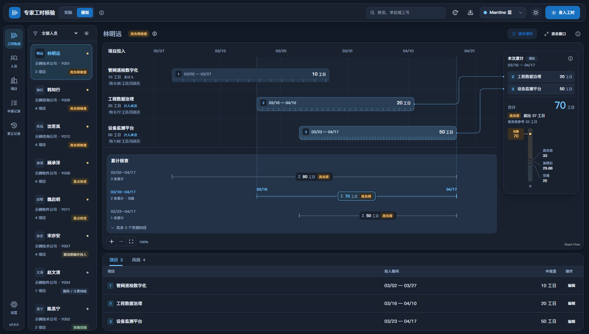

<div align="center">

# 专家工时校验工具

**按人员查看跨项目投入，让每一项累计都有来源。**


[快速开始](#快速开始) · [功能](#功能) · [模拟案例](#模拟案例) · [开发](#开发) · [项目文档](#项目文档)

</div>

面向专家及技术人员工时台账的本地核验工具，将同一人员在多个项目中的投入放到同一时间轴，分别检查**跨项目累计、项目实施期、职称与计费等级**。录入后直接核验，编辑保存后重新计算，并保留更正历史。

> 当前提供模拟规则筛查。期间交叉、超过参考容量、合同计费差异分别表达；筛查结果不直接作为重复报工或结算审减结论。

## 界面预览


项目投入以淡蓝时间条展示，核查范围以短竖刻度和细线独立成行，选中后突出起止日期与蓝色范围线；参与累计的完整申报通过连接线对应右侧分项与参考轴。截图使用内置模拟数据。

<details>
<summary>查看深色主题</summary>



</details>

## 功能

| 能力 | 使用方式 |
| --- | --- |
| 跨项目累计 | 按人员汇总完整核查窗口内的有效申报，对照常规、加班后及高负荷参考量；工时、人月逐项显示换算为工日的算式 |
| 实施期检查 | 核对人员投入起止日期、项目实施期及来源，提示期外投入和缺失依据 |
| 职称与计费检查 | 核对职称证明、有效期、计费等级、单价、单位及合同依据 |
| 平均投入密度 | 整条蓝色越深、底部刻纹越密，整段平均投入越高；显示申报工日 ÷ 日历天数，不代表实际逐日投入 |
| 可追溯的工时图 | 点击范围切换累计，悬停或键盘聚焦关联来源；支持逐步演示、缩放与适配 |
| 台账维护 | 新增人员、项目及工时，按姓名、单位或工号搜索；同名人员按内部 ID 区分 |
| 更正留痕 | 保存修订与只读历史快照，多页面写入使用版本冲突检测 |
| 导出与备份 | CSV 核验结果、打印明细、JSON 备份与恢复，恢复前自动备份当前台账 |
| 本地运行 | 构建后前端资源由本地服务提供，核心计算不调用大模型或外部 API；支持亮暗主题 |

画布中的日期通过表单修改。切换核查窗口时，其他项目保持原位置，未计入项适度淡化，便于核对来源。

## 快速开始

### 环境要求

- **Python 3.10+**：后端只使用标准库，无需安装 Python 第三方依赖。
- **Node.js 20（≥20.19）或 22 及以上（≥22.12），并安装 npm**：用于安装前端依赖和构建；本机验证环境为 Node.js 24.14.1、Python 3.14.3。

### 从源码运行

```bash
git clone https://github.com/zgzzmnbx/zaojia-WorkTime.git
cd zaojia-WorkTime
npm ci
npm run build
python server.py
```

| 入口 | 地址 | 初始内容 |
| --- | --- | --- |
| 业务台账 | [http://127.0.0.1:8791/](http://127.0.0.1:8791/) | 空台账，用于自行录入 |
| 模拟案例 | [http://127.0.0.1:8791/?demo=1](http://127.0.0.1:8791/?demo=1) | 12 人、6 个项目、34 条申报 |

顶部“实际 / 模拟”可直接切换两套台账，当前选项以蓝色高亮；旁边的 info 入口可查看数据与规则说明。

首次启动会自动创建两个独立数据库。业务台账也使用模拟规则，和“模拟案例”的区别是数据来源。

### Windows 日常启动

首次完成构建后，双击根目录的 `启动工时核验-【codex】.bat`，即可启动服务并打开浏览器。日常运行只需要 Python；启动器会检测端口占用，不抢占其他应用的端口。

也可指定端口和数据目录：

```bash
python server.py --port 8792 --data-dir ./data-local
```

服务当前仅监听 `127.0.0.1`。内网多机访问、账号权限和认证签字尚未交付。

## 使用流程

1. 在“项目”中录入项目及实施期依据。
2. 在“人员”中维护单位、工号、职称及证明有效期。
3. 点击“录入工时”，填写投入期间、数量、单位和计费依据。
4. 在“工时轨迹”选择人员与核查范围，查看完整来源、分项累计和三类检查。
5. 需要修正时编辑原记录，保存后重算；通过“更正记录”查看历史，或导出结果与备份。

当前界面按录入量直接核验，无需另填认定量或完成应用内审批。

## 模拟案例

在模拟入口按姓名搜索，即可查看不同情景：

| 人员 | 代表情景 | 观察重点 |
| --- | --- | --- |
| 林明远 · 示例技术公司 | 三项目共 58 工日，完整窗口为 47 日历天 | 高负荷参考、完整来源连线及六步演示 |
| 陈思宁 | 两项目共 15 工日 | 期间交叉，累计仍在参考容量内 |
| 周启航 | 两项目先后接续 | 非交叉投入的时间关系 |
| 赵文清 | 实施期外投入、等级及单价不符 | 三类检查独立呈现 |
| 陆景和 / 宋亦安 / 顾承泽 / 韩知行 | 同一期间分别申报 24 / 32 / 38 / 48 工日 | 常规、轻度、重点、高负荷四档模拟结果 |
| 魏启明 | 304 工时，按模拟参数折合 38 工日 | 工时单位换算 |
| 沈若岚 | 全期 36 工日，局部 12 日历天申报 18 工日 | 局部超量不能被全期总量掩盖 |
| 许嘉禾 | 缺投入日期及人月换算依据 | 待补依据，保留记录 |

示例人员、单位和项目均为模拟数据。同名的另一位林明远属于不同单位，独立计算。

## 核验口径

- **完整窗口累计**：仅累计完整落入所选核查窗口的有效记录，不把不同窗口的合计继续相加。
- **期间交叉**：日期相交不代表实际重复报工；缺少逐日投入时，不把全期申报量或按天分摊量作为交叉段实际量。
- **依据不足**：日期、折算或合同依据不完整时提示待补；没有人员投入期但有项目实施期时，只按实施期估算并标明待补。
- **参考量**：工时折算、加班参考、容差和年度日历可在设置中维护。示例日历仅按周一至周五计算，不能替代真实年度法定日历。
- **正式结论**：当前程序只接受模拟规则 v0.1.0，正式参数和合同审减口径仍需业务批准。

## 数据与备份

```text
data/
├── ledger.sqlite3    # 业务台账
├── demo.sqlite3      # 模拟案例
└── backups/          # 恢复前自动保存的台账副本
```

数据在首次运行时创建，不随源码发布；构建不会删除台账。业务库与模拟库分别保存，切勿相互覆盖。

页面导出的 JSON 包含当前台账、参数、日历及最近 200 条历史摘要，用于当前状态迁移与恢复；每个历史版本的完整正文保存在数据库中。完整灾备应**先停止服务，再复制整个 `data/` 目录**。恢复 JSON 前，服务自动保存当前台账副本。

同一服务支持多个浏览器读写与版本冲突检测。不要用多台电脑同步同一个正在运行的 SQLite 文件替代共享服务。“操作人”用于编辑留痕，不是经过认证的账号身份。

## 开发

### 技术栈

| 层次 | 实现 |
| --- | --- |
| 前端 | React 19、Vite 8 |
| 工时画布 | React Flow 12，自定义节点与原生连线 |
| 样式与图标 | Tailwind CSS 4、daisyUI 5、Phosphor Icons |
| 服务与规则 | Python 标准库 HTTP 服务、独立规则引擎 |
| 存储 | SQLite，当前状态与追加修订历史 |

### 常用命令

```bash
npm ci                   # 按锁文件安装依赖
npm test                 # Python 规则、持久化及 HTTP 测试
npm run test:ui-logic     # 前端累计、风险映射与容量对照测试
npm run build            # 构建前端到 dist/
npm start                # 启动 Python 本地服务
```

前端修改后重新构建并刷新页面。关键录入、泳道和编辑流程还需实际浏览器验收，构建和自动测试不替代业务验收。

### 目录结构

```text
zaojia-WorkTime/
├── src/
│   ├── main.jsx                 # 工作台与表单
│   ├── FlowTimeline.jsx         # React Flow 工时图
│   ├── WindowContributions.jsx  # 累计来源分项
│   ├── CapacityGauge.jsx        # 参考刻度
│   ├── timelineRisk.js          # 前端核查映射
│   └── *.css                    # 主题与布局
├── engine.py                    # 三类检查与输入校验
├── server.py                    # HTTP、SQLite、导出及备份
├── sample_data.py               # 内置模拟案例
├── tests/                       # 服务与前端逻辑测试
├── tools/launch.ps1             # Windows 启动器
├── 00-docs/                     # 需求、计划、验收及预览图片
├── 启动工时核验-【codex】.bat
└── package.json
```

`node_modules/`、`dist/`、本地数据库、临时证据及原始业务任务资料不纳入仓库。克隆后需自行构建，原始资料在本地保留。

## 项目文档

- [改进版需求与边界](00-docs/00-PRD/01-改进版任务包-v0.1.0-【codex】.md)
- [当前版本计划与验收](00-docs/00-PRD/02-当前版本计划.md)
- [初版任务包评审](00-docs/Opus任务包契合度评审-v1.0.0-【codex】.md)
- [首版验收记录（历史）](00-docs/验收记录-v0.1.0-【codex】.md)
- [版本记录](CHANGELOG.md) · [历史归档](CHANGELOG-历史归档.md)

界面与项目版本为 **v0.3.3**，规则与服务版本为 **v0.1.0**。真实项目对照、正式合同规则、内网多机部署、Excel/WPS 打开 CSV 及签字验收仍待验证。
